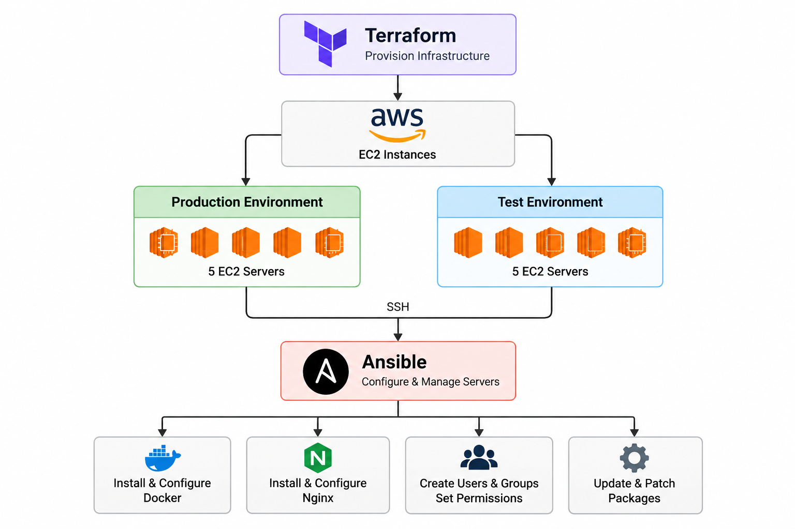
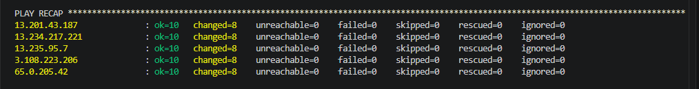
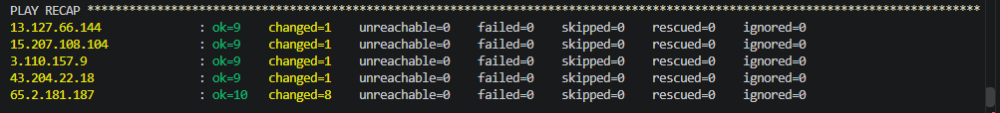

# AWS Infrastructure & Ansible Automation Project

## Project Overview

This project demonstrates the use of **Terraform and Ansible together to provision and automate Linux servers on AWS**.

Terraform is used to provision the AWS infrastructure, while Ansible is used to configure, patch, and manage the servers automatically.

The infrastructure is divided into **Production and Test environments**, demonstrating infrastructure provisioning and configuration management across multiple servers and environments.

---

## Architecture

The project consists of:

- AWS Cloud
- 10 Amazon Linux EC2 instances
  - 5 Production servers
  - 5 Test servers
- Terraform for infrastructure provisioning
- Ansible for configuration management and automation
- Docker
- Nginx
- SSH-based server management

### Architecture Diagram



---

## Terraform Infrastructure

Terraform is used to provision the AWS infrastructure required for the project.

The Terraform configuration includes:

- EC2 instances
- 5 Production servers
- 5 Test servers
- Networking configuration
- Security groups
- SSH access configuration
- Infrastructure outputs for server public IP addresses

Terraform allows the complete lab infrastructure to be created and destroyed consistently using Infrastructure as Code.

---

## Ansible Automation

After Terraform provisions the infrastructure, **Ansible is used to configure and manage the Linux servers**.

The automation includes:

- Managing Production and Test environments through Ansible inventory
- Installing required packages
- Installing Docker and Nginx
- Starting and enabling Docker and Nginx services
- Creating Linux users
- Creating Linux groups
- Creating application, operations, and security directories
- Managing directory ownership and permissions
- Updating and patching installed packages
- Deploying Nginx configuration files
- Using handlers to restart Nginx when configuration changes
- Verifying Nginx after configuration
- Using variables and loops to make automation reusable
- Demonstrating idempotent configuration management

---

## Ansible Concepts Practiced

The project demonstrates practical use of:

- Inventory
- Playbooks
- Variables
- Loops
- Package module
- Service module
- User module
- Group module
- File module
- Copy module
- Command module
- Handlers
- Privilege escalation (`become`)
- Idempotency

---

## Project Structure

```text
Ansible-Project/
├── Terraform/
│   ├── provider.tf
│   ├── network.tf
│   ├── ec2.tf
│   ├── variables.tf
│   ├── outputs.tf
│   └── .terraform.lock.hcl
│
├── production_practice.yml
├── test_setup.yml
├── variables.yml
├── nginx.conf
├── inventory.example.ini
├── .gitignore
├── architecture.png
├── production-recap.PNG
├── test-recap.PNG
└── README.md
```

---

## Automation Workflow

```text
Terraform
    │
    ▼
AWS Infrastructure
    │
    ├── 5 Production EC2 Servers
    │
    └── 5 Test EC2 Servers
    │
    ▼
Ansible Inventory
    │
    ▼
Ansible Playbooks
    │
    ├── Install Packages
    ├── Start & Enable Services
    ├── Create Users & Groups
    ├── Create Directories
    ├── Configure Permissions
    ├── Patch Linux Servers
    ├── Deploy Nginx Configuration
    ├── Trigger Nginx Handler
    └── Verify Nginx
    │
    ▼
Configured Production & Test Environments
```

---

## Project Results

The automation was successfully executed across both environments.

### Production

- 5 EC2 servers configured using Ansible
- Packages installed successfully
- Docker and Nginx configured and running
- Users and groups created
- Directories and permissions configured
- Packages patched
- Nginx configuration deployed
- Nginx verified successfully
- Final execution completed with `failed=0` and `unreachable=0`

### Test

- 5 EC2 servers configured using Ansible
- Same configuration automatically applied to the Test environment
- Final execution completed with `failed=0` and `unreachable=0`

---

## Execution Results

### Production Environment



### Test Environment



---

## How to Run

### 1. Provision the Infrastructure

Navigate to the Terraform directory:

```bash
cd Terraform
```

Initialize Terraform:

```bash
terraform init
```

Review the infrastructure:

```bash
terraform plan
```

Create the infrastructure:

```bash
terraform apply
```

### 2. Configure the Ansible Inventory

Use `inventory.example.ini` as a template and create a local `inventory.ini`.

Add the public IP addresses generated by Terraform under the Production and Test groups.

Configure the SSH username and private key path.

The real `inventory.ini` is excluded from GitHub using `.gitignore`.

### 3. Run Production Automation

```bash
ansible-playbook -i inventory.ini production_practice.yml
```

### 4. Run Test Automation

```bash
ansible-playbook -i inventory.ini test_setup.yml
```

### 5. Verify the Results

Review the Ansible PLAY RECAP and confirm:

```text
failed=0
unreachable=0
```

### 6. Destroy the Infrastructure

After completing the lab:

```bash
terraform destroy
```

---

## Security and Repository Practices

The `.gitignore` file prevents sensitive or generated files from being committed, including:

- Terraform state files
- Terraform provider directories
- SSH private keys
- Local Ansible inventory
- Terraform variable files containing environment-specific or sensitive values

An `inventory.example.ini` file is provided as a safe template instead of publishing the real inventory.

---

## Skills Demonstrated

**AWS | Terraform | Ansible | Linux | Docker | Nginx | Infrastructure as Code | Configuration Management | Server Automation | SSH | Git & GitHub**

---

## Key Takeaway

This project demonstrates an end-to-end infrastructure and configuration management workflow:

**Terraform provisions the AWS infrastructure, and Ansible automatically configures and manages the Linux servers across separate Production and Test environments.**
